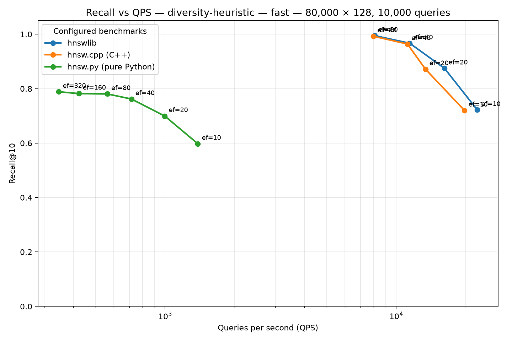

# VecSearch

VecSearch is a collection of vector search algorithms and a local benchmark
harness for comparing them on the same data, metric, and methodology.
**hnswlib** is included as the baseline implementation.

The goal is a small, reproducible lab: add an algorithm, point the harness at
it, and see its recall/QPS trade-off on the same graph as everything else.



## Quick start

```bash
cd scripts/bench
uv sync
uv run vecbench run --preset default
```

Other useful commands:

```bash
uv run vecbench list
uv run vecbench show-config --preset default
uv run vecbench run --preset fast
uv run vecbench run --preset default --n 50000 --queries 500
uv run vecbench run --preset default --ef 10,20,40,80
uv run vecbench run --preset fast --label baseline
```

See [`scripts/bench/README.md`](scripts/bench/README.md) for the full CLI,
presets, and benchmark-system API.

## Repository layout

| Path                      | Purpose                                    |
| ------------------------- | ------------------------------------------ |
| `scripts/bench/`          | Python benchmark harness (uv project)      |
| `vendors/hnswlib/`        | Baseline HNSW implementation               |
| `vendors/ann-benchmarks/` | Reference dataset and algorithm collection |
| `apps/`                   | In-repo algorithm implementations          |

## Algorithms

| Algorithm | Status   | Notes                                                    |
| --------- | -------- | -------------------------------------------------------- |
| hnswlib   | Included | Baseline; HNSW with cosine, L2, and inner-product spaces |
| hnsw.py   | Included | Pure-Python HNSW; cosine, L2, and inner-product spaces   |
| hnsw.cpp  | Included | C++ port of hnsw.py; cosine, L2, and inner-product spaces |

New algorithms are added to the same benchmark graph as they are implemented.

## Adding an algorithm

1. Add the library under `apps/<name>/` for an in-repo implementation, or
   `vendors/<name>/` for an external/reference library used as a control.
2. Create `scripts/bench/bench/systems/<name>.py` with functions for:
   - building an index
   - applying query parameters
   - single-query search
   - batch search
   - index size
3. Create a `BenchmarkSystem` instance and add it to `SYSTEMS` in
   `scripts/bench/bench/systems/__init__.py`.
4. Add the parameters to a preset in `scripts/bench/bench/presets.py`.
5. Run the preset. The new algorithm appears on the combined graph
   automatically.

No changes to the runner, metrics, report, or CLI are required.

## Benchmark methodology

- Seeded synthetic clustered Gaussian vectors are generated once per run.
- Exact ground truth is computed in chunked NumPy using the same metric.
- Each configured benchmark builds its own index and sweeps its query
  parameters (`ef` for hnswlib, hnsw.cpp, and hnsw.py).
- `ef` sweeps auto-extend until recall reaches `metrics.target_recall` or the
  `metrics.max_ef` cap, so the sweep does not need to be specified manually.
- Sequential mode times one query at a time and reports p50/p95/p99 latency.
- Batch mode calls the library's batch query path for throughput.
- Recall@k, QPS, and latency are recorded per sweep point; QPS is the median
  over repeated runs.

The `fast` preset is sized for an Apple M1 Air with 8 GB RAM and includes
every registered system. The 1M `default` preset is heavier; increase `--n`
for an even longer run.
